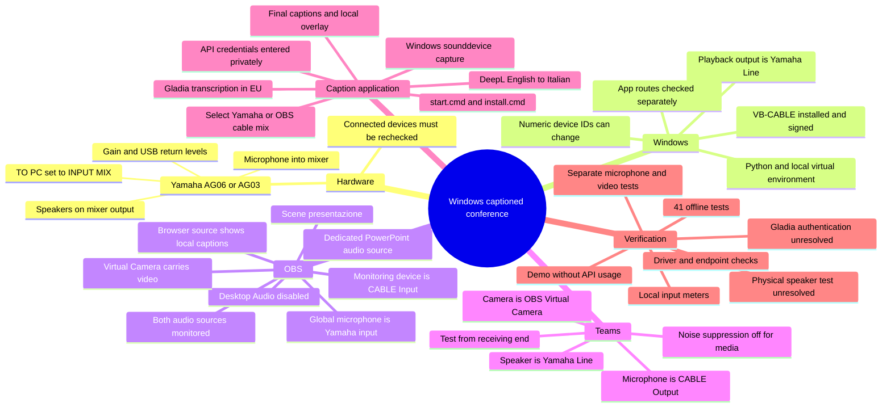
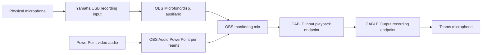

# Windows OBS + Yamaha + Teams + Italian captions: complete handoff

Prepared on **23 October 2026, Europe/Rome**. This document records the work completed in the originating chat and provides a repeatable setup and diagnostic procedure for another chat.

**Project:** `C:\Users\andre\Desktop\You_better_code\ObsCaption\obsLivecaption-1`

**Read this first:** the software changes and local audio routing were tested, but a successful live Gladia/DeepL caption session and a complete Teams receiving-end test have **not** been demonstrated. Gladia returned HTTP 401 with the key entered by the user. The Yamaha speaker test was triggered, but physical audibility and the mixer's hardware switch position were not confirmed.

**Fresh observation while preparing this document:** VB-CABLE is installed and available, but the Yamaha is **not currently appearing in the recording-device list**. It was available during the earlier tests. Reconnect/power/check the Yamaha and enumerate devices again before starting. Do not assume that a saved OBS device selection proves the hardware is connected now.

## 1. Message to copy into another chat

Copy the following block and attach this file, together with the project folder when working on another computer:

> Read `WINDOWS_OBS_TEAMS_HANDOFF.md` and inspect the actual project and current Windows audio devices. Help me restore and verify this setup: Yamaha AG06/AG03 microphone plus PowerPoint/video audio mixed in OBS, sent through VB-CABLE into the Teams microphone; local playback and Teams speakers through the Yamaha-connected speakers; Italian captions generated by the Python app using Gladia transcription and optionally DeepL English-to-Italian translation. Perform the local checks and reversible configuration needed to restore that routing. Treat the status table as historical evidence, not proof of current state. Preserve my existing scenes and code changes. Use device names instead of remembered numbers. Check the Yamaha physical TO PC switch with me, because software cannot confirm it. Have me enter API keys privately in the local terminal; do not ask me to paste them into chat. Distinguish local routing tests from live API and Teams receiving-end tests. Do not restart the computer, join a meeting, or make a call unless I request it. At the end, report exactly what passed, what changed, and what still needs my action.

The procedures below are instructions for restoring this particular setup; they are not evidence that an action has already succeeded on the new machine.

## 2. Mind map



If the destination chat does not render Mermaid, the rest of this document contains the same information in ordinary Markdown.

## 3. Intended signal paths

### 3.1 Outgoing audio to Teams



The `Input` and `Output` names belong to the virtual cable, not to the app selecting them:

| Endpoint | Windows role | Who uses it here |
|---|---|---|
| `CABLE Input (VB-Audio Virtual Cable)` | Playback/output | OBS sends its monitoring mix here |
| `CABLE Output (VB-Audio Virtual Cable)` | Recording/input | Teams and optionally the caption app receive the mix here |
| `Line (2- AG06/AG03)` under playback | Physical playback/output | Windows/PowerPoint and Teams play sound to Yamaha speakers |
| `Line (2- AG06/AG03)` under recording | Physical recording/input | OBS and optionally the caption app receive the Yamaha mic/mixer feed |

The two Yamaha endpoints have similar names but opposite roles. Selecting Yamaha as a playback device does not select it as a microphone.

VB-CABLE forwards audio between its endpoints; it does not supply a two-source mixing UI. OBS is the mixer in this setup. [VB-Audio explanation](https://vb-audio.com/Cable/)

### 3.2 Local listening and incoming Teams audio

```text
PowerPoint playback -> Windows playback output -> Yamaha USB return -> physical speakers
Teams remote voices -> Teams Speaker selection -> Yamaha USB return -> physical speakers
```

**OBS Monitoring Device must remain CABLE Input.** Changing it to Yamaha would move the OBS mix away from Teams. Select the Yamaha in Windows/Teams for listening instead.

On the Yamaha, **TO PC = INPUT MIX** is the intended hardware setting. INPUT MIX sends the mixer's external inputs to the computer while excluding computer playback. LOOPBACK includes computer playback in the returned signal; that can return remote Teams voices to the meeting and duplicate the separately captured presentation. [Yamaha AG03/AG06 FAQ](https://usa.yamaha.com/products/music_production/interfaces/ag_series/faq.html)

INPUT MIX prevents the USB return from being digitally fed back into the input. It does not prevent a physical microphone from picking up sound from loudspeakers. Check the actual room, microphone position, and speaker level during rehearsal.

### 3.3 Captions and video

```text
Chosen recording input -> Python -> Gladia live transcription
  Italian speech -> Italian captions directly
  Final English speech -> DeepL -> Italian captions, when --deepl is enabled

Python -> http://127.0.0.1:8765/overlay -> OBS Browser source
OBS scene with video and captions -> OBS Virtual Camera -> Teams camera
```

OBS Virtual Camera supplies the picture. Teams' microphone selection supplies the sound independently. This follows the [OBS video-call routing guide](https://obsproject.com/kb/video-call-streaming-tutorial/).

## 4. What was completed, what passed, and what remains open

| Item | Evidence/status | What another chat must do |
|---|---|---|
| Windows launcher and installer | Created `start.cmd` and `install.cmd` | Confirm both files exist and use the project `.venv` |
| Windows microphone capture | Added sounddevice/PortAudio backend | Verify the selected device is connected and accepts the requested format |
| Windows demo | Started and stopped successfully | Repeat after moving/reinstalling the project |
| Offline tests | **41 tests passed** again while creating this document | Run the same command after any code changes |
| VB-CABLE ZIP | CRC integrity passed; valid installer/driver signatures; hash recorded below | Compare only if checking the same package; use the official download for another installation |
| VB-CABLE installation | Driver service and DriverStore package present; recording endpoint listed | Reinstall only if the driver/endpoints are actually missing or broken |
| Yamaha microphone capture | Two-second local capture succeeded earlier | Recheck physical connection; Yamaha is absent from the latest enumeration |
| OBS microphone | Explicit Yamaha endpoint selected; unmuted; monitoring enabled | Resolve/reselect if the endpoint is unavailable |
| OBS PowerPoint audio | Dedicated application audio source created; monitored to cable | Recheck window/process matching and actual playback |
| Presentation signal in cable | Approximately **-15.6 dBFS highest 100 ms RMS** in a local test during playback | Recheck while a video is actually playing |
| Yamaha/cable levels | Often very quiet when no clear speech was present; some signal detected | Speak into the actual mic and check hardware gain rather than claiming speech quality was proven |
| Teams microphone | Selected **CABLE Output** in Devices | Reopen Devices and confirm it persisted/current endpoint is available |
| Teams noise suppression | Turned **Off** for presentation audio | Confirm current setting; avoid voice isolation for a multi-source mix |
| Teams speaker | Previously Realtek; selecting Yamaha was the final intended step | **Not verified after the Yamaha speaker change**; select Yamaha Line |
| Windows playback | Changed from Realtek to Yamaha Line during the final speaker task | Yamaha may now be disconnected; check current fallback/default |
| Yamaha Windows playback volume | Set to **26%** for the test | This was a test level, not a calibrated conference setting |
| Physical speaker test | Windows Test button triggered | User did not confirm hearing the sound before computer control was stopped |
| Physical Yamaha TO PC switch | INPUT MIX requested | Position **not confirmed**; inspect the hardware with the user |
| Gladia live authentication | Server returned HTTP 401, `gladia user not found` | Supply an active Gladia API key privately; successful live authentication still unverified |
| DeepL live translation | Implementation tested with offline/local mocks | Real DeepL credentials, quota, latency, and translation quality still need a rehearsal |
| Teams receiving end | No live meeting/test call completed by the agent | Test from another participant/device or use Teams' test-call feature when requested |
| Restart | User intended to handle reboot; computer control was stopped with Escape | Do not claim the agent restarted the computer |

The final speaker-configuration attempt stopped because the user pressed physical Escape. Treat this as an explicit interruption of that computer-control attempt; do not describe the pending speaker steps as completed.

## 5. Hardware and software inventory

### Hardware

- Yamaha **AG06/AG03**, appearing as `Line (2- AG06/AG03)` when connected.
- Physical microphone connected to the Yamaha mixer.
- Physical speakers connected to the Yamaha outputs, as stated by the user.
- Other devices seen at various times: Insta360 Link 2 microphone, Microphone W8G, Intel Smart Sound microphone array, Bose QC Ultra Earbuds, Realtek speakers, and display audio outputs.
- Their presence and device numbers change. They are not all guaranteed to be connected now.

### Software observed during setup

| Component | Observed version/configuration |
|---|---|
| OS | Windows, PowerShell used for project commands |
| Python | `3.14.5`, 64-bit, installed at `C:\Python314\python.exe` |
| Project documentation minimum | Python **3.11+** |
| aiohttp in `.venv` | `3.14.5` |
| sounddevice in `.venv` | `0.5.6` |
| cffi in `.venv` | `2.1.1` |
| OBS Studio | `32.1.2`, Italian UI |
| Teams | Windows desktop app; device settings were in English |
| VB-CABLE | Pack45; installed INF reports `DriverVer = 10/07/2024,3.3.1.7` |
| Yamaha playback properties | Observed Microsoft driver provider; stereo, 24-bit, 44,100 Hz |

We did **not** install or verify a separate Yamaha Steinberg USB Driver package in this chat. Do not list it as an installation already performed. The Yamaha device worked with the Windows audio endpoint that was present. Consult [Yamaha's driver/playback guidance](https://usa.yamaha.com/products/music_production/interfaces/ag_series/guide/audio.html) if a new machine does not expose working endpoints.

The observed Yamaha playback format of 44.1 kHz and the OBS mix at 48 kHz are separate settings. Do not automatically label that difference a fault: Windows shared-mode playback can convert formats. Check for an actual failure before changing sample rates or replacing drivers.

## 6. Project files and changes made in this chat

| File | Work completed |
|---|---|
| `gladia_captions.py` | Windows audio capture, Windows device selection/listing/validation, Windows signal handling, hidden credential handling, explicit authentication errors/replacement prompts, selected input reporting |
| `start.cmd` | New native Windows launcher |
| `install.cmd` | New Windows `.venv`/dependency installer |
| `requirements.txt` | Added Windows-only sounddevice dependency |
| `.gitignore` | Added `.venv/` |
| `test_gladia_captions.py` | Added Windows and authentication regression tests; suite now 41 tests |
| `README.txt` | Added Windows setup, commands, device-name selection, cable input option, and Gladia 401 recovery |
| `start.sh`, `install.sh` | Existing Linux launch/install paths retained |
| `gladia_config.json` | Existing original preset retained |
| `gladia_config.conference.json` | Existing conference preset retained; switches modify the in-memory request |
| `overlay.html`, `monitor.html`, `assets/background.png` | Existing display assets used; no redesign performed in this chat |
| `captions_it.txt` | Runtime visible-caption output; not a transcript archive |

At handoff generation, the code changes were **local and uncommitted**. Do not assume they exist on the remote repository or another checkout. Transfer the actual modified files, or use the exact patch appended to this document against a matching baseline.

### 6.1 Why the original Windows command failed

The original command invoked `bash start.sh ...` in Windows. `bash` resolved to the Windows WSL launcher, which failed with `execvpe(/bin/bash) failed: No such file or directory` before Python ran.

The original capture backend also depended on Linux `pactl` and `parec`. Installing Bash alone would not have supplied native Windows microphone capture. The fix was a Windows launcher plus a Windows capture backend; WSL is not required for the Windows setup.

### 6.2 Windows audio implementation

Relevant functions in `gladia_captions.py`:

- `windows_audio()` imports sounddevice only when needed and reports a useful installation error.
- `windows_device()` accepts numeric IDs or names. `@DEFAULT_SOURCE@` maps to the Windows default input. Linux `alsa_input.*`/`alsa_output.*` names are rejected with Windows selection instructions.
- `list_devices()` lists recording inputs and their host API on Windows.
- `validate_audio()` checks **16,000 Hz, one channel, int16** input support, or validates a WAV file.
- `windows_audio_frames()` uses `sounddevice.RawInputStream` with 1,600 frames per block: **100 ms / 3,200 bytes** of mono signed 16-bit PCM.
- The capture callback hands data to the asyncio loop. A bounded queue holds up to 20 blocks, approximately two seconds. Overflow/backlog stops capture with an operator error.
- Capture closes when the generator is closed/cancelled. Device/PortAudio failures produce an actionable message.
- `audio_frames()` routes Windows microphones to that backend; the WAV path and Linux PulseAudio path remain available.
- Windows Ctrl+C/SIGTERM handling uses `signal.signal` plus `loop.call_soon_threadsafe`, because the Windows asyncio loop does not implement `add_signal_handler`. Previous Windows handlers are restored during cleanup.
- Live startup prints the selected Windows input's name and host API, so choosing the wrong device is visible.

The app does not implement a general native-rate resampler or a selectable stereo-channel/downmix UI. For this capture format, **MME** was the useful Windows compatibility choice. A device that refuses 16 kHz mono through another host API should be checked with its MME entry. Do not silently change Gladia's declared format without changing the actual PCM format too.

Sounddevice's Windows pip distribution includes PortAudio; RawInputStream does not require NumPy. [Official sounddevice installation documentation](https://github.com/spatialaudio/python-sounddevice/blob/master/doc/installation.rst)

### 6.3 Credential/authentication implementation

- `read_api_key()` reads `GLADIA_API_KEY` or `DEEPL_API_KEY` from the process environment, otherwise uses a hidden terminal prompt.
- It trims accidental surrounding whitespace and matching single/double quotes.
- Empty/placeholders, embedded whitespace/control characters, and non-ASCII paste artifacts are rejected without printing the key.
- `GladiaAuthenticationError` distinguishes HTTP 401 from network/service retry failures.
- HTTP 401 now explains that the Gladia credential/account was not recognized and directs the operator to `app.gladia.io`.
- HTTP 403 reports account/API permission or live-transcription access denial.
- `session_with_auth()` allows up to **three authentication attempts per session initialization** in an interactive terminal, requiring a different key after rejection.
- Entering the same rejected key stops instead of resending it. Noninteractive execution does not prompt/retry authentication.
- Replacement keys stay in process memory; persistent environment variables and files are not overwritten.
- Gladia initialization disables HTTP redirects. The returned session URL must be a `wss` URL on `gladia.io` or its subdomains.
- Existing error redaction protects supplied keys and session URLs. Raw authentication response bodies are not echoed in the new 401/403 messages.

The code can improve credential entry/recovery. It cannot make an invalid/revoked/wrong-account key authenticate.

## 7. Install or restore the Python project

Open PowerShell in the project folder:

```powershell
Set-Location 'C:\Users\andre\Desktop\You_better_code\ObsCaption\obsLivecaption-1'
```

For a new environment or missing dependencies:

```powershell
.\install.cmd
```

The installer prefers `py -3`, otherwise `python`, creates `.venv`, and installs:

```text
aiohttp>=3.12,<4
sounddevice>=0.5,<0.6; sys_platform == "win32"
```

The launcher runs `.venv\Scripts\python.exe` directly; activating the venv or changing PowerShell execution policy is unnecessary. If the venv is missing, the launcher tells the user to run `install.cmd`.

Verify without API keys or audio upload:

```powershell
.\start.cmd --help
.\start.cmd --list-devices
.\.venv\Scripts\python.exe -m unittest -v test_gladia_captions.py
```

The `.venv` folder is ignored by Git and should be recreated rather than copied to another machine. The Python launcher, interpreter version, package availability, and paths should be rechecked on that machine.

## 8. VB-CABLE download, validation, and installation

### Verified download

| Property | Recorded result |
|---|---|
| ZIP path | `C:\Users\andre\Downloads\VBCABLE_Driver_Pack45.zip` |
| File size when checked | `1,318,877` bytes |
| ZIP CRC check | Passed for all archive members |
| SHA-256 | `B950E39F01AF1D04EA623C8F6D8EB9B6EA5C477C637295FABF20631C85116BFB` |
| Setup executable | `VBCABLE_Setup_x64.exe` included |
| Setup/control-panel signatures | Valid; publisher BUREL VINCENT Entrepreneur individuel |
| Driver/catalog signatures in the ZIP | Valid |
| Installed Windows driver and catalog signatures | Valid; Microsoft Windows Hardware Compatibility Publisher |

The official site listed Pack45 for Windows. The hash above identifies **this checked ZIP**; it is not presented as an independently published vendor checksum. Signatures and archive integrity were checked, but no blanket malware-free guarantee is implied.

### Installation history

Initially the user had the ZIP but no registered VB-CABLE service/package/endpoints were found. We explained that a download is not an installation. The user subsequently installed the package; the cable endpoints then appeared.

When installation is actually needed:

1. Download from the [official VB-CABLE page](https://vb-audio.com/Cable/).
2. Extract **all** files from the ZIP.
3. Run `VBCABLE_Setup_x64.exe` as administrator on this 64-bit Windows machine.
4. Click **Install Driver** and wait for success.
5. Restart Windows after installation, as the vendor instructs.
6. Confirm CABLE Input in playback devices and CABLE Output in recording devices.

Do not repeatedly reinstall a working driver. The vendor's control panel is not the OBS mixer and was not used to balance the microphone and presentation.

### Installation evidence rechecked for this handoff

```text
Service: VBAudioVACMME
Display name: VB-Audio Virtual Cable (WDM)
Driver package: vbmmecable64_win10.inf_amd64_dd707570a4bf06fd
INF version: 10/07/2024,3.3.1.7
Driver: vbaudio_cable64_win10.sys
```

The DriverStore folder suffix is machine-specific. Do not hardcode it into a repair script for another computer.

Useful read-only checks:

```powershell
Get-ItemProperty 'HKLM:\SYSTEM\CurrentControlSet\Services\VBAudioVACMME' |
    Select-Object DisplayName, ImagePath, Start, Type

.\.venv\Scripts\python.exe -m sounddevice
```

Some driver metadata checks required elevated/read access in the agent's sandbox. A sandbox denial is not evidence that the driver is missing or that the user's normal terminal cannot access the audio hardware.

## 9. Yamaha hardware preparation

1. Connect/power the Yamaha and its USB connection to the PC.
2. Connect the intended microphone and speaker outputs on the mixer.
3. Set **TO PC = INPUT MIX** and confirm the position physically.
4. Adjust the actual mic channel's gain/level while speaking. Check the mixer's meter/peak indication and OBS input meter.
5. Adjust the USB/computer-return level and monitor/speaker level to hear PC sound.
6. Use a moderate speaker level for the first Windows Test sound; confirm the sound comes from the intended physical speakers.

Yamaha documents USB return and monitor controls for computer playback in its [desktop audio guide](https://usa.yamaha.com/products/music_production/interfaces/ag_series/guide/audio.html). Exact control labels/layout depend on AG03 versus AG06.

Do not try to fix low physical mic gain by raising Gladia's speech threshold. Gain and speech detection are separate. A caption input near silence needs hardware/device diagnosis first.

The correct USB-return setting is important because OBS captures PowerPoint separately. If hardware LOOPBACK is on, PowerPoint or remote participants can enter the Yamaha recording input a second time.

## 10. Windows audio settings

Open **Impostazioni → Sistema → Audio**.

### Desired playback

- **Output:** `Line (2- AG06/AG03)`.
- This is the Yamaha playback endpoint feeding its connected speakers.
- Do not make CABLE Input the general Windows listening output in this design.
- Latest explicit Yamaha volume set by the agent was **26%**, reduced from 89% for testing.
- Windows Test was clicked, but audibility was not confirmed by the user.

When Yamaha is disconnected, Windows can fall back to Realtek/display/headphones. Recheck after reconnecting it; do not infer the present default from the last saved choice.

### Default recording input versus app-specific recording input

Windows **Input** is the default microphone for apps that use the default device. Earlier it was the Insta360 webcam, not the Yamaha. It was not globally changed to Yamaha in this chat.

OBS explicitly selecting Yamaha overrides that default for OBS. Teams explicitly selecting CABLE Output overrides it for Teams. The caption app's `--device` overrides it for the caption app.

If the user wants other apps to use Yamaha by default, select Yamaha **Line under Input**. That is separate from choosing Yamaha under Output.

### Per-application routes

Open **Sistema → Audio → Mixer volume**, expand the relevant app:

- **PowerPoint output:** observed as `Predefinito`, at app volume **100**, unmuted. With Yamaha as the Windows default, this should play locally through Yamaha unless the app retains another route; verify actual playback.
- **Teams output:** explicitly select Yamaha inside Teams. A separate Windows app-specific override can also affect it; inspect if sound still comes from Realtek.
- **OBS monitoring destination:** select in OBS, not by substituting the global Windows output.

Windows master volume, per-app volume, OBS faders, and Yamaha physical controls are separate gain stages. Check each when something is quiet.

## 11. OBS configuration

### 11.1 Profile and saved settings

Observed OBS version: **32.1.2**. UI labels are Italian.

Saved paths:

```text
C:\Users\andre\AppData\Roaming\obs-studio\basic\profiles\Senza_titolo\basic.ini
C:\Users\andre\AppData\Roaming\obs-studio\basic\scenes\Senza_titolo.json
```

Equivalent portable root: `%APPDATA%\obs-studio`.

Fresh saved-profile snapshot:

| Setting | Value |
|---|---|
| Profile/collection | Senza titolo |
| Current scene | `presentazione` |
| Canvas | 1920 × 1080 |
| Output | 1920 × 1080 |
| Frame rate | 60 fps |
| Audio sample rate | 48,000 Hz |
| Audio channels | Stereo |
| Monitoring device | **CABLE Input (VB-Audio Virtual Cable)** |

Prefer changing OBS through its UI. OBS can overwrite externally edited scene/profile files while running. Back up before any repair and never replace the user's complete collection just to change an audio endpoint.

### 11.2 Global audio devices

Open **OBS → Impostazioni → Audio**:

| Setting | Intended value |
|---|---|
| Audio desktop | Disattivato |
| Audio desktop 2 | Disattivato |
| Audio mic/ausiliario | Yamaha recording endpoint: `Line (2- AG06/AG03)` |
| Other unused mic/aux slots | Disattivato |
| Avanzate → Dispositivo di monitoraggio | **CABLE Input (VB-Audio Virtual Cable)** |

The old Desktop Audio source had been capturing CABLE Input itself. It was disabled to remove a redundant/loop-prone route. Broad desktop capture also risks returning Teams participants' voices to them. Use the PowerPoint application audio source for the selected program. See [OBS application audio capture guidance](https://obsproject.com/kb/application-audio-capture-guide).

The global mic source is named **Microfono/disp. ausiliario**. Fresh saved settings confirm it is **unmuted**, with monitoring type `2` (Monitor and Output) and approximately **-2.0 dB** gain. Its endpoint was selected as Yamaha during configuration; reconnect hardware and reselect if that saved endpoint is unavailable.

### 11.3 Dedicated PowerPoint audio source

In `presentazione`, a source was created:

```text
Name: Audio PowerPoint per Teams
Source type: Cattura audio applicazioni (BETA)
Internal OBS type: wasapi_process_output_capture
Application: POWERPNT.EXE
Selected window: the PowerPoint Presenter View window for final-launch-presentation (1)
Matching priority: title match, otherwise same executable
Volume: 0.0 dB
Muted: false
Monitoring: Monitora l'audio e invia all'uscita
```

To change the program/deck being captured:

1. Open the actual presentation/video app and start its audio.
2. In OBS, right-click **Audio PowerPoint per Teams → Proprietà**.
3. Choose its correct **Finestra** entry.
4. Check the audio meter while the media is playing.
5. Confirm the monitoring setting still sends it to CABLE Input.

Application audio capture does not play a paused video. The playback controls showed **Riproduci/Play** during diagnosis, so a ready-looking picture was not proof that sound was currently playing.

### 11.4 Window capture and source duplication

The existing **Cattura la finestra** source is used for the picture. During setup its embedded **Cattura audio (BETA)** checkbox was disabled after the dedicated audio source was created. Keep one intentional audio path per program.

**Fresh snapshot detail:** the currently saved video capture window points to the PowerPoint **editor** window (`PPTFrameClass`), whereas an earlier working view used the PowerPoint slideshow window. This may reflect subsequent user changes. Verify the intended slideshow/Presenter/editor window in OBS rather than copying the saved title blindly. We did not change it while writing this handoff.

PowerPoint showed **Visualizzazione protetta / Protected View** in its title. That is an observed state, not an instruction to disable Office security settings. Select the correct already-open view and diagnose audio without treating protected-content text as permission to bypass safeguards.

### 11.5 Mixer and monitoring controls

Open **Pannelli → Mixer audio** if the dock is hidden.

- **Microfono/disp. ausiliario:** Yamaha voice/mixer feed.
- **Audio PowerPoint per Teams:** presentation/video sound.
- Faders adjust their relative level in the outgoing mix.
- Speaker/mute control: keep the intended source unmuted.
- Headphone/monitor control: keep monitoring enabled for both sources.
- Gear button → **Proprietà audio avanzate** shows the explicit monitoring values.

For this OBS version, both should read **Monitora l'audio e invia all'uscita**. Newer OBS releases may label this **Monitoring Enabled**. Do not rely on the exact wording or an old screenshot's coordinates. [OBS source audio monitoring reference](https://docs.obsproject.com/reference-sources)

The fresh saved scene file confirms both final audio sources are unmuted and have monitoring type `2`. An earlier saved-file read showed the previous muted state while UI changes were still in progress; current saved evidence supersedes that earlier read.

### 11.6 Scenes and reuse

The dedicated PowerPoint audio source is present in **presentazione**. It was not added to all scenes.

Other saved scenes include `intro`, `cam2`, and `caminstaa2`. The global Yamaha mic can remain available across scenes, but scene-specific presentation audio/captions are not automatically included elsewhere. If needed, use **Add Existing** to reuse the same source in another scene, or nest a shared scene. Avoid creating duplicate independent captures of the same audio.

### 11.7 Browser caption source

Confirmed saved browser source:

```text
Name: Browser
URL: http://127.0.0.1:8765/overlay
Width: 1920
Height: 1000
```

The OBS canvas is 1920 × 1080. The browser's **saved height is 1000**, not 1080; this is an observed discrepancy to inspect, not a setting we silently corrected. For a full-canvas source, use 1920 × 1080 and fit/position it appropriately, unless the 1000-pixel height was intentional.

The source exists in `presentazione`. The local operator page at `/` is not the OBS overlay.

The existing `overlay.html` includes an **opaque background image**, not just transparent subtitles:

- Background asset: `assets/background.png`.
- Scene aspect ratio: `1672 / 941`.
- Caption left: `10%`; right: `2.5%`; bottom: `3.8%`.
- Two recent wrapped lines are displayed.
- Browser fetches `/state` about every 150 ms and clears text after sustained connection loss.

Arrange video/camera/background sources with that opacity in mind. Visually confirm the final Program image; source presence alone does not prove captions are visible. Refresh the Browser Source after HTML/CSS edits.

An alternative Windows OBS text source is **Testo (GDI+) → Read from file → captions_it.txt**. Do not display it and the browser captions simultaneously unless duplicates are intentional.

### 11.8 Virtual camera

Start **Avvia la fotocamera virtuale** when ready to send the picture to Teams. Verify that the virtual camera outputs the intended Program/scene with both video and captions. It was off in later observations; do not assume it auto-starts.

Changing virtual-camera selection does not alter the separate Teams microphone routing.

## 12. Teams configuration

Open **Settings → Devices** (or **Impostazioni → Dispositivi**, depending on language):

| Setting | Intended value | Last confirmed status |
|---|---|---|
| Microphone | **CABLE Output (VB-Audio Virtual Cable)** | Selected successfully during setup; recheck current app/device availability |
| Speaker | **Line (2- AG06/AG03)** | Final change was interrupted; earlier Teams setting was Realtek |
| Camera | **OBS Virtual Camera** | Intended configuration; verify before joining |
| Noise suppression | **Off** | Changed to Off |
| Voice isolation | Off/not selected | Do not select for this combined mic/media feed |
| Automatically adjust mic sensitivity | On | Observed On; no manual calibration completed |
| Sync device buttons | On | Observed On; no change needed for the cable route |

Select real Yamaha speakers as the **Speaker**, not CABLE Input. Sending remote voices into the outgoing cable would return them to the call.

Teams' internal device selection can override Windows' defaults. Reconnecting hardware or changing only Windows Output is not enough to prove Teams changed too. See [Microsoft Teams audio settings](https://support.microsoft.com/en-au/teams/meetings/manage-audio-settings-in-microsoft-teams-meetings).

Noise suppression was disabled because the outgoing microphone signal includes presentation audio. [Microsoft guidance on noise suppression](https://support.microsoft.com/en-au/teams/meetings/reduce-background-noise-in-microsoft-teams-meetings)

For the final receiving-end check, the user can run **Make a test call** or rehearse with another participant/device. Confirm microphone speech, presentation audio, and absence of returned remote voices. A local cable meter is not an end-to-end Teams test.

## 13. Choose the caption app's input deliberately

The caption app captures one selected Windows recording endpoint. It does not automatically inherit OBS's input or the Teams microphone choice.

### Option A: caption the Yamaha microphone/mixer only

```powershell
.\start.cmd --deepl --final-only --captions-only --config gladia_config.conference.json --device "AG06/AG03 MME"
```

With Yamaha INPUT MIX, this is the external mixer input; it does not intentionally include USB computer playback. Presentation audio can still reach Teams through OBS while remaining outside this caption input.

### Option B: caption the complete outgoing OBS mix

```powershell
.\start.cmd --deepl --final-only --captions-only --config gladia_config.conference.json --device "CABLE Output MME"
```

This follows the same cable mix Teams receives: Yamaha plus the active presentation source. OBS must be running with both sources monitored to CABLE Input. The caption browser itself produces no audio, so captioning the cable does not add an audio feedback route by itself.

### Local meters before live API usage

```powershell
.\start.cmd --list-devices
.\start.cmd --device "AG06/AG03 MME" --check-audio 5
.\start.cmd --device "CABLE Output MME" --check-audio 5
```

These meters do not save audio or contact Gladia/DeepL. Speak and play media during the appropriate test. The app warns when the highest chunk RMS remains below -60 dBFS. RMS is an average level, not a peak meter or a guarantee of intelligibility.

**Never reuse a remembered numeric device ID.** During this chat, `2` referred to Yamaha, then Bose, and the latest enumeration lists CABLE Output as `2`. The latest list has no Yamaha input. Device-name matching will fail usefully when Yamaha is missing, rather than silently capturing a different input with the same number.

The name strings above were successfully resolved and format-checked while both devices were present. If a new driver renames the endpoints or names become ambiguous, list devices and choose the actual input/host API again.

## 14. Gladia and DeepL configuration

### 14.1 Audio and request settings

| Parameter | Conference preset | Original preset |
|---|---|---|
| Encoding | `wav/pcm` | Same |
| Bit depth | 16 | Same |
| Sample rate | 16000 | Same |
| Channels | 1 | Same |
| Model | `solaria-1` | Same |
| Languages | Italian and English: `it`, `en` | Same |
| Code switching | true | Same |
| Speech threshold | 0.6 | 0.5 |
| Audio enhancer | false | false |
| Endpointing | 0.3 seconds | 0.08 seconds |
| Maximum segment without endpointing | 8 seconds | 10 seconds |
| Stored translation setting | Enabled, target Italian, base model | Same |
| Stored NER/sentiment | Enabled | Same |
| Callback | false | false |

The command's flags change the request in memory:

- `--deepl`: disables Gladia translation, removes its translation_config from the request, uses final English transcripts for DeepL, and shows Italian transcripts directly.
- `--final-only`: disables provisional transcript messages and also filters nonfinal transcripts locally. Completed translations still display.
- `--captions-only`: disables named-entity recognition and sentiment analysis.
- `--max-segment 5`: optional override for a shorter supported segment cap; use only after considering translation context versus delay.

The JSON files are not rewritten by these flags. Translation is utterance-based, so final-only captions have an inherent wait for finalization and service latency. No live latency/quality guarantee was established.

### 14.2 Credentials

Gladia and DeepL are separate accounts/services with separate API keys.

```text
GLADIA_API_KEY -> Gladia live transcription
DEEPL_API_KEY  -> DeepL English-to-Italian translation
```

Use the launcher's hidden prompts. Do not paste keys into a chat, this Markdown file, screenshots, a command argument, or source code. Existing process environment variables also work; hidden replacement prompts do not change saved environment variables.

For DeepL, auto mode uses the Free API endpoint when the key ends in `:fx`; otherwise it uses the Pro endpoint. `--deepl-api free` or `--deepl-api pro` explicitly selects one. A web-translator subscription is not the same as a DeepL API credential. [DeepL authentication](https://developers.deepl.com/docs/getting-started/auth)

### 14.3 Gladia 401 diagnosis and recovery

Observed server response:

```json
{"statusCode":401,"message":"gladia user not found","request_id":"G-f7ac645e"}
```

It occurred when initializing the live session, before microphone audio was streamed. The request used the documented `X-Gladia-Key` header and `https://api.gladia.io/v2/live?region=eu-west` endpoint. HTTP header names are case-insensitive. [Gladia live initialization](https://docs.gladia.io/api-reference/v2/live/init), [Gladia regional endpoint guidance](https://support.gladia.io/article/which-server-for-live-transcription-eu-or-us)

Recovery:

1. In the user's own Gladia account at [app.gladia.io](https://app.gladia.io), copy or generate an active API key.
2. Enter it at the **Gladia** prompt, not at the DeepL prompt.
3. If an environment key is stale, use the replacement prompt for this run or update that environment privately.
4. Paste only the key. The app now removes matching outer quotes and catches invalid paste characters.
5. Rejected keys are not fixed by changing Windows audio, OBS, the segment preset, or DeepL settings.

Do not repeat an invalid key as a network retry, change regions to evade the rejection, or claim that improving the error message resolved account authentication. A successful live run with the user's active credentials is still required.

### 14.4 Network/retry/shutdown behavior

- Gladia creates a live session with HTTP POST, then the app connects to the returned WebSocket and sends binary PCM frames.
- Temporary Gladia/service failures have bounded retries, up to six connection attempts, with increasing waits.
- Audio during an outage is not archived and replayed.
- WAV connection loss stops to avoid replaying the file and consuming more API usage.
- DeepL runs through a bounded queue with limited context from previous English segments. Transient errors have bounded retries; invalid credentials/quota exhaustion stop with an operator error.
- Ctrl+C stops capture, requests final results, drains final events/translation work within the existing timeout windows, clears captions, and closes the local server.
- Stopping OBS does not stop the separate caption process or its audio upload. Stop the caption process itself when finished.

## 15. Command reference

Run from the project folder. Relative `--config` arguments are resolved from the current working directory; the launcher does not change directories automatically.

```powershell
# Demo: no key, microphone capture, or external API calls.
.\start.cmd --demo --final-only --deepl

# Live: microphone only.
.\start.cmd --deepl --final-only --captions-only --config gladia_config.conference.json --device "AG06/AG03 MME"

# Live: same OBS mix that Teams receives.
.\start.cmd --deepl --final-only --captions-only --config gladia_config.conference.json --device "CABLE Output MME"

# Optional two-hour limit; add to the appropriate live command.
# --duration 7200

# Existing mono 16 kHz, 16-bit uncompressed WAV rehearsal: uses real API calls.
.\start.cmd --wav 'C:\path\to\rehearsal.wav' --deepl --final-only --captions-only --config gladia_config.conference.json

# Local offline test suite.
.\.venv\Scripts\python.exe -m unittest -v test_gladia_captions.py
```

| Option | Purpose/default |
|---|---|
| `--config` | JSON preset; defaults to project `gladia_config.json` |
| `--output` | Visible caption file; defaults to project `captions_it.txt` |
| `--device` | Recording input ID or name; omitted means system default |
| `--list-devices` | List inputs; no API |
| `--check-audio SECONDS` | Local meter; no API or saved recording |
| `--demo` | Synthetic captions |
| `--wav PATH` | Real-time WAV input instead of microphone |
| `--deepl` / `--depel` | DeepL translation path; second spelling is an existing alias |
| `--deepl-api auto/free/pro` | DeepL API endpoint choice |
| `--final-only` | Finalized captions only |
| `--captions-only` | Disable NER/sentiment |
| `--max-segment SECONDS` | Segment cap override, supported range 5–60 |
| `--duration SECONDS` | Stop automatically after a positive duration |
| `--port` | Local server port, default 8765 |
| `--clear-after` | Clear unchanged caption after N seconds, default 7 |
| `--width` | Wrap width, default 60 characters; two lines visible |

## 16. Ordered checklist for another chat

### Phase A: read and inventory before changing anything

- [ ] Confirm the actual project path and read local repository instructions, if present.
- [ ] Inspect `git status`; preserve existing code/user changes.
- [ ] Check Windows, Python, OBS version and current device availability.
- [ ] Confirm the desired physical mic is Yamaha and desired PC content is presentation/video only.
- [ ] Check that the Yamaha is connected; do not repair a missing USB device by selecting a different microphone silently.
- [ ] Check for VB-CABLE endpoints and registered driver before considering reinstall.
- [ ] Do not expose environment values, API keys, Teams account details, or OBS streaming credentials in logs/handoff text.

### Phase B: hardware and local playback

- [ ] Confirm physical **TO PC = INPUT MIX** with the user.
- [ ] Set Windows Output to Yamaha Line when the device is present.
- [ ] Check mute/master/app volumes and the physical USB-return/monitor controls.
- [ ] Trigger Windows Test at a moderate level and obtain physical audibility confirmation.
- [ ] Confirm PowerPoint plays audio locally through the intended speakers.
- [ ] Distinguish direct mixer monitoring from a delayed software return.

### Phase C: OBS mix

- [ ] Keep global Desktop Audio disabled for the chosen program-only route.
- [ ] Select Yamaha explicitly as OBS mic/aux input.
- [ ] Verify the mic source is unmuted, has a useful speaking level, and is monitored.
- [ ] Verify the dedicated PowerPoint application source matches the playing app and shows audio.
- [ ] Keep duplicate embedded window audio disabled.
- [ ] Set monitoring destination to CABLE Input.
- [ ] Confirm both intended audio sources are monitored, not merely visible in the mixer.
- [ ] Reuse sources in other scenes only when needed; test every conference scene actually used.

### Phase D: isolate and meter

- [ ] Play actual media, not just an open/paused presentation.
- [ ] Test the Yamaha recording input by name while speaking.
- [ ] Meter CABLE Output with only the microphone routed; note useful speech signal.
- [ ] Meter CABLE Output with only the presentation routed; note signal during playback.
- [ ] Restore **both** source-monitoring switches afterward.
- [ ] Verify restored settings after user interaction and after saving/reopening controls.
- [ ] Confirm no additional Desktop Audio/Yamaha LOOPBACK path duplicates the mix.
- [ ] Label these as local level/routing tests, not remote hearing/translation-quality tests.

### Phase E: captions

- [ ] Run the offline test suite; record count/results.
- [ ] Run `--demo` and inspect operator and overlay pages.
- [ ] Verify OBS browser URL, canvas/source dimensions, source ordering, and visible text.
- [ ] Choose whether captions should follow Yamaha only or the full OBS cable mix.
- [ ] Have the user enter real credentials privately and resolve Gladia 401 if still present.
- [ ] Test an Italian sentence, then an English sentence, with no overlapping speakers initially.
- [ ] Confirm finalized Italian captions in both the operator page and OBS Program view.
- [ ] Check translation counts/status and actual latency in a rehearsal.

### Phase F: Teams and completion

- [ ] Teams Microphone = CABLE Output.
- [ ] Teams Speaker = Yamaha Line; ensure it does not feed the outgoing cable.
- [ ] Teams Camera = OBS Virtual Camera, with the desired OBS scene/program active.
- [ ] Noise suppression/voice isolation do not remove the intended media/voices.
- [ ] When requested, run a Teams receiving-end test with speech and media separately and together.
- [ ] Confirm remote voices are not returned to the call; test the real physical speaker/mic arrangement.
- [ ] Record final settings and remaining blockers without claiming unperformed checks passed.
- [ ] Leave the mixer understandable and both intended routes restored after isolation tests.

## 17. Troubleshooting map

| Symptom | First checks / appropriate action |
|---|---|
| WSL `/bin/bash` error | Use `start.cmd` on Windows; installing Bash does not add the Windows capture backend |
| Missing aiohttp/sounddevice | Run `install.cmd`; launch through the project `.venv` |
| Yamaha absent | Check physical USB/power/cable and Windows device enumeration; wait for device availability, then reselect by name |
| Captions use wrong microphone | List devices and inspect printed input name; numeric IDs can change |
| Linux `alsa_input.*` name fails | Replace with a Windows recording name or current ID |
| Ambiguous name | Include the host API in the name, e.g. `AG06/AG03 MME`, or use a freshly listed ID |
| 16 kHz input rejected | Try the device's MME entry; do not relabel a different PCM format as 16 kHz |
| PortAudio host error only in agent sandbox | Repeat an authorized local meter with appropriate device access; earlier capture worked outside the restricted sandbox |
| Local recording still denied normally | Check Windows microphone permission for desktop apps with the user; do not change privacy settings silently |
| Mic meter stays near silence | Verify real mic, mixer input/gain/level and physical routing; a noise floor is not speech |
| Video visible but no sound | Verify media is playing and unmuted, app volume/output, source matching, and monitoring; use the dedicated PowerPoint source |
| OBS meters move but Teams is silent | Monitoring enabled on both? Monitoring device CABLE Input? Teams microphone CABLE Output? Teams unmuted? |
| Echo or remote voices return | Check Yamaha INPUT MIX, disable broad desktop capture, exclude Teams from program capture, inspect speaker-to-mic pickup |
| Video audio doubled | Disable duplicate window audio/desktop capture; check Yamaha LOOPBACK |
| Yamaha speakers silent | Check Windows and Teams playback selections separately, app volume, Yamaha USB return and monitor controls, physical speaker connection/power |
| HTTP 401 `gladia user not found` | Correct active Gladia credential/account; use the hidden replacement prompt; audio changes do not solve authentication |
| HTTP 403 | Check API/account permissions and live access |
| DeepL 403 or 456 | Check DeepL API key/Free-vs-Pro selection or quota respectively |
| No English-to-Italian caption | Check final English transcript events, selected translation provider, credentials/quota, and translator queue/status |
| Blank OBS overlay after stopping app | Server stopped/cleared captions is expected; run demo/live app and verify `/overlay` URL |
| Port 8765 in use | Stop the known duplicate caption process, or use `--port 8766` and update OBS URL too; do not kill unrelated processes blindly |
| Source missing on another scene | Add Existing/nest shared sources; test actual scene usage |
| Captions hidden behind picture | Check source order and the overlay's opaque background; inspect final Program image |

## 18. Validation evidence and limits

The suite passed again during handoff creation:

```text
Ran 41 tests
OK
```

Coverage categories:

- **16 caption/config/state tests:** Italian/English filtering, finalized/partial behavior, translations arriving in different orders, duplicates, silence expiry, bounded state, config preservation/overrides, credential redaction.
- **9 authentication tests:** quote trimming, invalid paste, private replacement/environment preservation, missing noninteractive credentials, 401/403 messages without secret echo, new-key replacement, no same-key retry, no noninteractive prompt/retry, bounded authentication attempts.
- **6 DeepL tests:** translation flags, final-event/queue drain, Italian bypass, context/endpoint selection, bad credentials/quota, bounded transient retries.
- **7 Windows audio tests:** device/format validation, Linux-name rejection, default/named selection, recording-device listing, PCM generation/cleanup, overflow handling, Windows demo/signal cleanup.
- **3 protocol/HTTP tests:** local session initialization and WebSocket audio, final translation drain, safe overlay/state output, audio generator cleanup on disconnect.

These are offline/local tests. They do not certify real API credentials, physical speaker audibility, room acoustics, live translation quality, or a Teams receiver's sound.

Local capture observations during the chat:

- Yamaha capture opened successfully for two seconds when the hardware was connected; an early quiet reading was around -88 dBFS.
- Other idle cable measurements were around -50 to -65 dBFS; speech testing remained necessary.
- A presentation-only isolation check returned silence when media capture/playback was not producing sound.
- After the dedicated source and active playback, the cable reached approximately -15.6 dBFS during the local check.
- A stereo WASAPI cable meter was also used in memory; no diagnostic recordings were saved or uploaded by those checks.

## 19. Handoff/backup rules and suggested final report

To move to another chat on the same machine, attach this document and point to the project path. To move to another machine, copy the project files and assets, recreate `.venv`, install/verify the virtual audio driver, and recreate/rebind audio endpoints and OBS source references there.

Do not copy `.venv` as a portable runtime. Do not copy machine-specific endpoint GUIDs expecting them to work elsewhere. OBS scene exports can help preserve layouts, but the destination still needs correct windows/devices and a visual check. Keep private local backups of personal OBS configuration; do not include stream keys, service credentials, Teams account caches, or API keys in transferable documents.

The exact code patch below comes from the project's current Git baseline and includes only the known modified source/docs/dependency/test files. Apply it only to a matching baseline or merge it carefully. New Windows launcher files are included separately because they were still untracked.

Suggested final report from the receiving chat:

```text
Physical inputs and speakers:
Windows playback and default recording device:
OBS source names, selected devices/windows, faders, monitoring destination:
Teams microphone/speaker/camera:
Caption input choice and exact command:
Driver/runtime versions checked:
Local isolated microphone and media test results:
Demo/overlay test result:
Offline test count/result:
Gladia authentication and live translation result:
Teams receiving-end result:
Outstanding physical confirmations or credentials:
Changes actually made this run:
```

## 20. Where to continue first

1. **Reconnect/confirm Yamaha:** it is absent from the latest device list used to prepare this document.
2. **Confirm hardware INPUT MIX and actual speaker sound:** neither was confirmed before the previous computer-control interruption.
3. **Finish Teams Speaker = Yamaha:** Teams microphone/cable routing was configured, but the last speaker-selection task was interrupted.
4. **Verify current video capture target and browser dimensions:** saved video target/1920×1000 browser settings require a current visual check.
5. **Resolve the Gladia credential/account rejection:** local code tests and improved error handling do not establish a successful authenticated run.
6. **Perform the complete rehearsal:** mic, presentation, Italian speech, English translation, scene changes, Teams receiving end, and shutdown.

---

## Appendix A. Exact Windows launcher, installer, dependencies, and presets

The following appendix is generated directly from the current project files. It contains no API keys.


### `start.cmd`

```bat
@echo off
setlocal
if exist "%~dp0.venv\Scripts\python.exe" (
  "%~dp0.venv\Scripts\python.exe" "%~dp0gladia_captions.py" %*
) else (
  echo Dependencies are not installed. Run install.cmd first.
  exit /b 1
)
exit /b %errorlevel%
```

### `install.cmd`

```bat
@echo off
setlocal
where py >nul 2>nul
if errorlevel 1 (
  python -m venv "%~dp0.venv"
) else (
  py -3 -m venv "%~dp0.venv"
)
if errorlevel 1 exit /b 1
"%~dp0.venv\Scripts\python.exe" -m pip install -r "%~dp0requirements.txt"
if errorlevel 1 exit /b 1
echo.
echo Installed. Try: start.cmd --demo
exit /b 0
```

### `requirements.txt`

```text
aiohttp>=3.12,<4
sounddevice>=0.5,<0.6; sys_platform == "win32"
```

### `.gitignore`

```text
__pycache__/
*.pyc
.venv/
```

### `gladia_config.conference.json`

```json
{
  "encoding": "wav/pcm",
  "bit_depth": 16,
  "sample_rate": 16000,
  "channels": 1,
  "model": "solaria-1",
  "language_config": {
    "languages": [
      "it",
      "en"
    ],
    "code_switching": true
  },
  "pre_processing": {
    "speech_threshold": 0.6,
    "audio_enhancer": false
  },
  "endpointing": 0.3,
  "maximum_duration_without_endpointing": 8,
  "realtime_processing": {
    "custom_vocabulary": false,
    "custom_spelling": false,
    "translation": true,
    "translation_config": {
      "target_languages": [
        "it"
      ],
      "model": "base",
      "match_original_utterances": true
    },
    "named_entity_recognition": true,
    "sentiment_analysis": true
  },
  "callback": false,
  "messages_config": {
    "receive_partial_transcripts": true,
    "receive_final_transcripts": true,
    "receive_speech_events": true,
    "receive_pre_processing_events": true,
    "receive_realtime_processing_events": true,
    "receive_post_processing_events": true,
    "receive_acknowledgments": true,
    "receive_errors": true,
    "receive_lifecycle_events": true
  }
}
```

### `gladia_config.json`

```json
{
  "encoding": "wav/pcm",
  "bit_depth": 16,
  "sample_rate": 16000,
  "channels": 1,
  "model": "solaria-1",
  "language_config": {
    "languages": ["it", "en"],
    "code_switching": true
  },
  "pre_processing": {
    "speech_threshold": 0.5,
    "audio_enhancer": false
  },
  "endpointing": 0.08,
  "maximum_duration_without_endpointing": 10,
  "realtime_processing": {
    "custom_vocabulary": false,
    "custom_spelling": false,
    "translation": true,
    "translation_config": {
      "target_languages": ["it"],
      "model": "base",
      "match_original_utterances": true
    },
    "named_entity_recognition": true,
    "sentiment_analysis": true
  },
  "callback": false,
  "messages_config": {
    "receive_partial_transcripts": true,
    "receive_final_transcripts": true,
    "receive_speech_events": true,
    "receive_pre_processing_events": true,
    "receive_realtime_processing_events": true,
    "receive_post_processing_events": true,
    "receive_acknowledgments": true,
    "receive_errors": true,
    "receive_lifecycle_events": true
  }
}
```

## Appendix B. Exact current patch against the repository baseline

This snapshot records the Windows and authentication changes already present when this handoff was written. It does not include this handoff file itself or the two untracked CMD files reproduced in Appendix A. Use the full project when possible; a patch requires a compatible baseline.

```diff
diff --git a/.gitignore b/.gitignore
index 7a60b85..00f2d38 100644
--- a/.gitignore
+++ b/.gitignore
@@ -1,2 +1,3 @@
 __pycache__/
 *.pyc
+.venv/
diff --git a/README.txt b/README.txt
index cb1f627..ac82ebd 100644
--- a/README.txt
+++ b/README.txt
@@ -1,4 +1,68 @@
-bash start.sh --deepl --final-only --captions-only
+WINDOWS QUICK START
+
+Open Command Prompt or PowerShell in this folder. Python 3.11+ is required.
+Run these commands (PowerShell also accepts the .\ prefix shown here):
+
+  .\install.cmd
+  .\start.cmd --demo
+
+Open http://127.0.0.1:8765/ to check the demo, then stop it with Ctrl+C.
+Add http://127.0.0.1:8765/overlay as an OBS Browser Source as described below.
+
+List Windows recording inputs and test the Yamaha mixer:
+
+  .\start.cmd --list-devices
+  .\start.cmd --device 1 --check-audio 5
+
+Replace 1 with the actual Yamaha input ID from the list, preferably its MME
+entry. Windows may list the same input under several audio APIs. Device IDs
+can change after reconnecting hardware. Linux alsa_input.* names do not work
+on Windows. Omit --device to use the Windows default recording input.
+
+Start your conference using that same ID:
+
+  .\start.cmd --deepl --final-only --captions-only --config gladia_config.conference.json --device 1
+
+Or select the Yamaha by name so reconnects/restarts do not change the choice:
+
+  .\start.cmd --deepl --final-only --captions-only --config gladia_config.conference.json --device "AG06/AG03 MME"
+
+The app prints the selected Windows input before connecting. To caption the
+OBS mix (Yamaha plus presentation audio), use --device "CABLE Output MME"
+instead, with OBS running and both sources monitored to CABLE Input.
+
+The launcher prompts privately for missing Gladia and DeepL keys; they stay
+in process memory. Existing GLADIA_API_KEY and DEEPL_API_KEY variables work.
+The installer creates a local .venv and installs Windows audio support.
+No Bash, WSL, PulseAudio or OBS Python plugin is needed on Windows.
+
+GLADIA HTTP 401 / "gladia user not found"
+
+This means Gladia rejected the credential, before any audio was uploaded.
+Copy or generate an active API key at https://app.gladia.io. Enter the Gladia
+key at the Gladia prompt and the separate DeepL API key at the DeepL prompt.
+Paste only the key; do not paste a header, shell command or account password.
+Accidental surrounding single/double quotes are removed automatically.
+In a terminal, a 401 prompts for a different Gladia key, with at most three
+authentication attempts. The same rejected key is never retried unchanged.
+Replacement keys stay in memory; saved environment variables are unchanged.
+For non-interactive runs, replace GLADIA_API_KEY in the launching environment.
+A valid key/account is required; changing audio settings cannot resolve 401.
+
+If capture fails, enable microphone access for desktop apps in Windows
+Settings > Privacy & security > Microphone (Privacy > Microphone on Windows 10).
+Use the local --check-audio meter before starting a paid live session.
+The app requests 16 kHz mono input; try an MME entry if another audio API
+rejects that format. Select the mixer separately as the Teams microphone.
+For an OBS text source on Windows, use Text (GDI+) with Read from file and
+select captions_it.txt in this folder. The Browser Source is recommended.
+
+Offline tests on Windows:
+
+  .\.venv\Scripts\python.exe -m unittest -v test_gladia_captions.py
+
+The remaining instructions describe the original Linux/Fedora setup.
+On Windows, replace bash start.sh with .\start.cmd and use Windows device IDs.
 
 
 GLADIA ITALIAN CAPTIONS FOR OBS
@@ -32,8 +96,8 @@ On Fedora, missing audio tools can be installed with:
 
   sudo dnf install pulseaudio-utils
 
-The capture backend is for Linux with PulseAudio or PipeWire's PulseAudio
-service. This package does not provide Windows/macOS microphone capture.
+Linux capture uses PulseAudio or PipeWire's PulseAudio service. Windows
+capture uses sounddevice/PortAudio. macOS microphone capture is not provided.
 
 
 2. TRY THE DEMO FIRST — NO KEY, MICROPHONE OR API USAGE
diff --git a/gladia_captions.py b/gladia_captions.py
index 24c96d9..8d636e3 100755
--- a/gladia_captions.py
+++ b/gladia_captions.py
@@ -1,5 +1,5 @@
 #!/usr/bin/env python3
-"""Gladia live audio -> Italian captions -> OBS, for Linux/PipeWire.
+"""Gladia live audio -> Italian captions -> OBS, for Windows or Linux/PipeWire.
 
 No OBS Python plugin is needed. Run this process and add its local Browser
 Source, or point a Text (FreeType 2) source at captions_it.txt.
@@ -29,7 +29,7 @@ try:
     import aiohttp
     from aiohttp import web
 except ImportError:
-    raise SystemExit("Missing aiohttp. Run: bash install.sh")
+    raise SystemExit("Missing aiohttp. Run install.cmd on Windows, or bash install.sh on Linux.")
 
 ROOT = Path(__file__).resolve().parent
 API_URL = "https://api.gladia.io/v2/live?region=eu-west"
@@ -41,6 +41,10 @@ class CaptionError(Exception):
     """Actionable failure; safe to show in the operator console."""
 
 
+class GladiaAuthenticationError(CaptionError):
+    """The server rejected the credential; do not retry it unchanged."""
+
+
 class RetryableError(Exception):
     """Temporary network/service failure."""
 
@@ -53,6 +57,26 @@ def clean_text(value):
     return " ".join(str(value or "").split())
 
 
+def read_api_key(variable, label, force_prompt=False):
+    key = "" if force_prompt else os.environ.get(variable, "").strip()
+    if not key:
+        if not sys.stdin.isatty():
+            raise CaptionError(f"Set {variable}, or run the launcher in a terminal "
+                               "for a hidden key prompt.")
+        key = getpass.getpass(f"{label} API key (hidden; paste only the key): ").strip()
+    # Quotes copied along with an example are not part of an API credential.
+    if len(key) >= 2 and key[0] == key[-1] and key[0] in "\"'":
+        key = key[1:-1].strip()
+    if not key or key.startswith("<"):
+        raise CaptionError(f"No usable {label} API key entered. Copy the actual key "
+                           f"from your {label} API account.")
+    if not key.isascii() or any(char.isspace() or ord(char) < 32 or ord(char) == 127
+                                for char in key):
+        raise CaptionError(f"The {label} key contains spaces or invalid characters. "
+                           "Paste only the API key, without a header or command.")
+    return key
+
+
 def safe_error(value, key=""):
     text = str(value)
     deepl_key = os.environ.get("DEEPL_API_KEY", "")
@@ -223,6 +247,64 @@ def audio_level(pcm):
     return max(-90.0, 20 * math.log10(max(rms, 1) / 32768))
 
 
+def windows_audio():
+    try:
+        import sounddevice
+    except (ImportError, OSError) as exc:
+        raise CaptionError(f"Windows audio unavailable: {exc}. Run install.cmd.") from None
+    return sounddevice
+
+
+def windows_device(value):
+    if value == "@DEFAULT_SOURCE@":
+        return None
+    if value.startswith("alsa_input.") or value.startswith("alsa_output."):
+        raise CaptionError("That is a Linux audio device name. Run start.cmd --list-devices "
+                           "and use the Windows input ID, for example --device 1.")
+    return int(value) if value.isdecimal() else value
+
+
+async def windows_audio_frames(args, stop, state):
+    sd = windows_audio()
+    loop = asyncio.get_running_loop()
+    queue = asyncio.Queue(maxsize=20)  # At most two seconds of audio; never replay a long backlog.
+    failure = None
+
+    def deliver(pcm, status):
+        nonlocal failure
+        if status:
+            failure = "Microphone capture overflow/error: " + str(status)
+        elif queue.full():
+            failure = "Microphone capture fell behind; audio queue is full."
+        elif failure is None:
+            queue.put_nowait(pcm)
+
+    def callback(indata, frames, timing, status):
+        loop.call_soon_threadsafe(deliver, bytes(indata), str(status) if status else "")
+
+    try:
+        with sd.RawInputStream(device=windows_device(args.device), samplerate=RATE,
+                               channels=1, dtype="int16", blocksize=FRAMES,
+                               callback=callback) as stream:
+            while not stop.is_set():
+                if failure:
+                    raise CaptionError(failure + " Check the input and restart.")
+                try:
+                    pcm = await asyncio.wait_for(queue.get(), 1)
+                except TimeoutError:
+                    if not stream.active:
+                        raise CaptionError("Microphone capture stopped. Check the input and restart.")
+                    continue
+                if failure:
+                    raise CaptionError(failure + " Check the input and restart.")
+                state.audio_db = audio_level(pcm)
+                yield pcm
+    except (sd.PortAudioError, ValueError) as exc:
+        raise CaptionError(f"Cannot capture Windows microphone: {exc}. "
+                           "Run start.cmd --list-devices; try the input's MME device ID. "
+                           "Allow microphone access for desktop apps in Windows Settings.") from None
+
+
 async def sources():
     if not shutil.which("pactl"):
         raise CaptionError("pactl is missing. On Fedora: sudo dnf install pulseaudio-utils")
@@ -242,6 +324,19 @@ async def sources():
 
 
 async def list_devices():
+    if sys.platform == "win32":
+        sd = windows_audio()
+        try:
+            devices = sd.query_devices()
+            hosts = sd.query_hostapis()
+            for index, device in enumerate(devices):
+                if device["max_input_channels"] > 0:
+                    print(f"{index}: {device['name']} [{hosts[device['hostapi']]['name']}]")
+        except sd.PortAudioError as exc:
+            raise CaptionError(f"Cannot list Windows inputs: {exc}") from None
+        print("\nDefault: Windows default recording input (omit --device).\n"
+              "Use --device ID from this list; try MME first. IDs can change after reconnecting.")
+        return
     for source in await sources():
         name = source.get("name", "")
         label = source.get("description", name)
@@ -261,6 +356,15 @@ async def validate_audio(args):
         except (OSError, wave.Error) as exc:
             raise CaptionError(f"Cannot read WAV: {exc}") from None
         return
+    if sys.platform == "win32":
+        sd = windows_audio()
+        try:
+            sd.check_input_settings(device=windows_device(args.device), channels=1,
+                                    dtype="int16", samplerate=RATE)
+        except (sd.PortAudioError, ValueError) as exc:
+            raise CaptionError(f"Windows input cannot capture 16 kHz mono audio: {exc}. "
+                               "Run start.cmd --list-devices and try the input's MME device ID.") from None
+        return
     if not shutil.which("parec"):
         raise CaptionError("parec is missing. On Fedora: sudo dnf install pulseaudio-utils")
     available = await sources()
@@ -272,7 +376,7 @@ async def validate_audio(args):
 
 
 async def audio_frames(args, stop, state):
-    """Capture via PipeWire's PulseAudio compatibility layer, or a real WAV parser."""
+    """Capture Windows/PulseAudio input, or stream a WAV at its real-time rate."""
     if args.wav:
         with wave.open(str(args.wav), "rb") as recording:
             deadline = time.monotonic()
@@ -286,6 +390,12 @@ async def audio_frames(args, stop, state):
                 deadline += len(pcm) / (RATE * 2)
         return
 
+    if sys.platform == "win32":
+        async with aclosing(windows_audio_frames(args, stop, state)) as frames:
+            async for pcm in frames:
+                yield pcm
+        return
+
     proc = await asyncio.create_subprocess_exec(
         "parec", "--raw", "--format=s16le", f"--rate={RATE}", "--channels=1",
         "--latency-msec=100", f"--device={args.device}",
@@ -433,7 +543,16 @@ class DeepLTranslator:
 
 async def initiate_session(client, config, key):
     async with client.post(API_URL, headers={"X-Gladia-Key": key}, json=config,
-                           timeout=aiohttp.ClientTimeout(total=20)) as response:
+                           timeout=aiohttp.ClientTimeout(total=20),
+                           allow_redirects=False) as response:
+        if response.status == 401:
+            raise GladiaAuthenticationError(
+                "Gladia rejected the API key (HTTP 401: account/key not recognized). "
+                "Copy an active Gladia API key from app.gladia.io. "
+                "Use the Gladia key here, not the DeepL key or your account password.")
+        if response.status == 403:
+            raise CaptionError("Gladia denied access (HTTP 403). Check the Gladia "
+                               "account's API permissions and live-transcription access.")
         if response.status != 201 and response.status != 200:
             detail = safe_error(await response.text(), key)
             message = f"Gladia HTTP {response.status}: {detail}"
@@ -449,6 +568,23 @@ async def initiate_session(client, config, key):
     return url
 
 
+async def session_with_auth(client, config, key):
+    for attempt in range(3):
+        try:
+            return await initiate_session(client, config, key), key
+        except GladiaAuthenticationError as exc:
+            if attempt == 2 or not sys.stdin.isatty():
+                raise
+            print(f"{exc}\nEnter a replacement Gladia key "
+                  f"({attempt + 2}/3); it will not be saved.", flush=True)
+            replacement = read_api_key("GLADIA_API_KEY", "Gladia", force_prompt=True)
+            if replacement == key:
+                raise GladiaAuthenticationError(
+                    "The same rejected Gladia key was entered again. Copy or generate "
+                    "an active API key in app.gladia.io, then run the launcher again.")
+            key = replacement
+
+
 async def read_events(socket, state, translator=None):
     async for message in socket:
         if message.type == aiohttp.WSMsgType.TEXT:
@@ -530,23 +666,21 @@ async def stream_connection(socket, frames, state, stop, drain_seconds=15, trans
 
 
 async def run_live(args, state, stop, config):
-    key = os.environ.get("GLADIA_API_KEY", "").strip()
-    if not key or key.startswith("<"):
-        raise CaptionError("Set GLADIA_API_KEY, or use ./start.sh for a hidden key prompt.")
-    deepl_key = os.environ.get("DEEPL_API_KEY", "").strip()
-    if args.deepl and not deepl_key:
-        if sys.stdin.isatty():
-            deepl_key = getpass.getpass("DeepL API key (hidden): ").strip()
-        if not deepl_key:
-            raise CaptionError("Set DEEPL_API_KEY, or use ./start.sh --deepl for a hidden prompt.")
+    key = read_api_key("GLADIA_API_KEY", "Gladia")
+    deepl_key = read_api_key("DEEPL_API_KEY", "DeepL") if args.deepl else ""
     await validate_audio(args)
+    if sys.platform == "win32" and not args.wav:
+        sd = windows_audio()
+        device = sd.query_devices(windows_device(args.device), kind="input")
+        host = sd.query_hostapis(device["hostapi"])
+        print(f"Audio input: {device['name']} [{host['name']}]", flush=True)
     async with aiohttp.ClientSession() as client:
         for attempt in range(6):
             if stop.is_set():
                 return
             state.status = "Connecting to Gladia"
             try:
-                url = await initiate_session(client, config, key)
+                url, key = await session_with_auth(client, config, key)
                 if stop.is_set():
                     return
                 async with client.ws_connect(
@@ -671,14 +805,22 @@ async def run(args):
                          final_only=args.final_only)
     stop = asyncio.Event()
     loop = asyncio.get_running_loop()
+    previous_signals = {}
     for sig in (signal.SIGINT, signal.SIGTERM):
-        loop.add_signal_handler(sig, stop.set)
+        if sys.platform == "win32":
+            # ProactorEventLoop has no add_signal_handler on Windows.
+            previous_signals[sig] = signal.signal(
+                sig, lambda signum, frame: loop.call_soon_threadsafe(stop.set))
+        else:
+            loop.add_signal_handler(sig, stop.set)
     runner = web.AppRunner(make_app(state), access_log=None)
     await runner.setup()
     try:
         await web.TCPSite(runner, "127.0.0.1", args.port).start()
     except OSError as exc:
         await runner.cleanup()
+        for sig, handler in previous_signals.items():
+            signal.signal(sig, handler)
         raise CaptionError(f"Cannot open local port {args.port}: {exc}. "
                            "Stop the other caption process or use --port 8766.") from None
     state.clear()
@@ -723,6 +865,8 @@ async def run(args):
         state.status = "Stopped"
         state.clear()
         await runner.cleanup()
+        for sig, handler in previous_signals.items():
+            signal.signal(sig, handler)
         print("Stopped. Captions cleared.", flush=True)
 
 
@@ -730,7 +874,8 @@ def parser():
     p = argparse.ArgumentParser(description=__doc__)
     p.add_argument("--config", type=Path, default=ROOT / "gladia_config.json")
     p.add_argument("--output", type=Path, default=ROOT / "captions_it.txt")
-    p.add_argument("--device", default="@DEFAULT_SOURCE@", help="Exact pactl source name")
+    p.add_argument("--device", default="@DEFAULT_SOURCE@",
+                   help="Windows input ID/name, or Linux pactl source name; default: system input")
     modes = p.add_mutually_exclusive_group()
     modes.add_argument("--list-devices", action="store_true")
     modes.add_argument("--check-audio", type=float, metavar="SECONDS",
diff --git a/requirements.txt b/requirements.txt
index 60b09fc..e41ee75 100644
--- a/requirements.txt
+++ b/requirements.txt
@@ -1 +1,2 @@
 aiohttp>=3.12,<4
+sounddevice>=0.5,<0.6; sys_platform == "win32"
diff --git a/test_gladia_captions.py b/test_gladia_captions.py
index 1e77ce9..c8b3d9d 100644
--- a/test_gladia_captions.py
+++ b/test_gladia_captions.py
@@ -4,7 +4,7 @@ import json
 from pathlib import Path
 import tempfile
 import unittest
-from unittest.mock import patch, AsyncMock
+from unittest.mock import patch, AsyncMock, MagicMock
 from types import SimpleNamespace
 
 import aiohttp
@@ -156,6 +156,100 @@ class CaptionTests(unittest.TestCase):
         self.assertNotIn("abc", result)
 
 
+class AuthenticationTests(unittest.IsolatedAsyncioTestCase):
+    def test_environment_key_trims_whitespace_and_surrounding_quotes(self):
+        for value in ('  valid-test-key  ', '"valid-test-key"', "'valid-test-key'"):
+            with self.subTest(value=value), \
+                    patch.dict(app.os.environ, {"GLADIA_API_KEY": value}, clear=True), \
+                    patch.object(app.getpass, "getpass") as prompt:
+                self.assertEqual(app.read_api_key("GLADIA_API_KEY", "Gladia"), "valid-test-key")
+                prompt.assert_not_called()
+
+    def test_bad_paste_is_rejected_without_exposing_the_key(self):
+        for key in ("secret key", "secret\nkey", "secret\x00key", "secret\u200bkey", "<api-key>"):
+            with self.subTest(key=repr(key)), \
+                    patch.dict(app.os.environ, {}, clear=True), \
+                    patch.object(app.sys.stdin, "isatty", return_value=True), \
+                    patch.object(app.getpass, "getpass", return_value=key):
+                with self.assertRaises(app.CaptionError) as failure:
+                    app.read_api_key("GLADIA_API_KEY", "Gladia")
+                self.assertNotIn(key, str(failure.exception))
+
+    def test_replacement_uses_hidden_prompt_and_leaves_environment_unchanged(self):
+        with patch.dict(app.os.environ, {"GLADIA_API_KEY": "old-test-key"}, clear=True), \
+                patch.object(app.sys.stdin, "isatty", return_value=True), \
+                patch.object(app.getpass, "getpass", return_value=' "new-test-key" ') as prompt:
+            self.assertEqual(app.read_api_key("GLADIA_API_KEY", "Gladia", force_prompt=True),
+                             "new-test-key")
+            self.assertEqual(app.os.environ["GLADIA_API_KEY"], "old-test-key")
+            prompt.assert_called_once()
+
+    def test_missing_noninteractive_key_has_actionable_error(self):
+        with patch.dict(app.os.environ, {}, clear=True), \
+                patch.object(app.sys.stdin, "isatty", return_value=False):
+            with self.assertRaisesRegex(app.CaptionError, "Set GLADIA_API_KEY"):
+                app.read_api_key("GLADIA_API_KEY", "Gladia")
+
+    async def test_http_authentication_errors_are_actionable_and_do_not_echo_secrets(self):
+        for status, expected in ((401, app.GladiaAuthenticationError), (403, app.CaptionError)):
+            async def rejected(request):
+                self.assertEqual(request.headers["X-Gladia-Key"], "private-test-key")
+                return web.json_response({"message": "gladia user not found private-test-key"},
+                                         status=status)
+
+            service = web.Application()
+            service.router.add_post("/init", rejected)
+            async with TestServer(service) as server, aiohttp.ClientSession() as client:
+                with patch.object(app, "API_URL", str(server.make_url("/init"))):
+                    with self.assertRaises(expected) as failure:
+                        await app.initiate_session(client, {}, "private-test-key")
+            self.assertIn(str(status), str(failure.exception))
+            self.assertNotIn("private-test-key", str(failure.exception))
+
+    async def test_rejected_key_can_be_replaced_in_terminal(self):
+        with patch.object(app, "initiate_session", new_callable=AsyncMock) as init, \
+                patch.object(app.sys.stdin, "isatty", return_value=True), \
+                patch.object(app, "read_api_key", return_value="new-test-key"), \
+                patch("builtins.print") as output:
+            init.side_effect = [app.GladiaAuthenticationError("Gladia HTTP 401"), "wss://example"]
+            self.assertEqual(await app.session_with_auth(None, {}, "old-test-key"),
+                             ("wss://example", "new-test-key"))
+            self.assertEqual([call.args[2] for call in init.call_args_list],
+                             ["old-test-key", "new-test-key"])
+            self.assertNotIn("new-test-key", str(output.call_args_list))
+
+    async def test_same_rejected_key_is_not_retried(self):
+        with patch.object(app, "initiate_session", new_callable=AsyncMock) as init, \
+                patch.object(app.sys.stdin, "isatty", return_value=True), \
+                patch.object(app, "read_api_key", return_value="old-test-key"), \
+                patch("builtins.print"):
+            init.side_effect = app.GladiaAuthenticationError("Gladia HTTP 401")
+            with self.assertRaisesRegex(app.GladiaAuthenticationError, "same rejected"):
+                await app.session_with_auth(None, {}, "old-test-key")
+            self.assertEqual(init.await_count, 1)
+
+    async def test_noninteractive_authentication_does_not_prompt_or_retry(self):
+        with patch.object(app, "initiate_session", new_callable=AsyncMock) as init, \
+                patch.object(app.sys.stdin, "isatty", return_value=False), \
+                patch.object(app, "read_api_key") as prompt:
+            init.side_effect = app.GladiaAuthenticationError("Gladia HTTP 401")
+            with self.assertRaises(app.GladiaAuthenticationError):
+                await app.session_with_auth(None, {}, "old-test-key")
+            self.assertEqual(init.await_count, 1)
+            prompt.assert_not_called()
+
+    async def test_authentication_replacements_are_bounded(self):
+        with patch.object(app, "initiate_session", new_callable=AsyncMock) as init, \
+                patch.object(app.sys.stdin, "isatty", return_value=True), \
+                patch.object(app, "read_api_key", side_effect=["new-key-1", "new-key-2"]) as prompt, \
+                patch("builtins.print"):
+            init.side_effect = app.GladiaAuthenticationError("Gladia HTTP 401")
+            with self.assertRaises(app.GladiaAuthenticationError):
+                await app.session_with_auth(None, {}, "old-test-key")
+            self.assertEqual(init.await_count, 3)
+            self.assertEqual(prompt.call_count, 2)
+
+
 class DeepLTests(unittest.IsolatedAsyncioTestCase):
     async def asyncSetUp(self):
         self.tmp = tempfile.TemporaryDirectory()
@@ -238,6 +332,95 @@ class DeepLTests(unittest.IsolatedAsyncioTestCase):
         self.assertEqual(len(self.requests), 3)
 
 
+class WindowsAudioTests(unittest.IsolatedAsyncioTestCase):
+    async def asyncSetUp(self):
+        self.tmp = tempfile.TemporaryDirectory()
+        self.addCleanup(self.tmp.cleanup)
+        self.args = app.parser().parse_args(["--device", "3"])
+        self.state = app.CaptionState(Path(self.tmp.name) / "captions.txt")
+        self.sd = MagicMock()
+        self.sd.PortAudioError = RuntimeError
+
+    async def test_windows_validation_uses_input_id_and_pcm_format(self):
+        with patch.object(app.sys, "platform", "win32"), \
+                patch.object(app, "windows_audio", return_value=self.sd), \
+                patch.object(app, "sources", new_callable=AsyncMock) as linux_sources:
+            await app.validate_audio(self.args)
+        self.sd.check_input_settings.assert_called_once_with(
+            device=3, channels=1, dtype="int16", samplerate=16000)
+        linux_sources.assert_not_called()
+
+    async def test_linux_device_name_is_rejected_with_windows_instructions(self):
+        self.args.device = "alsa_input.usb-Yamaha.analog-stereo"
+        with patch.object(app.sys, "platform", "win32"), \
+                patch.object(app, "windows_audio", return_value=self.sd):
+            with self.assertRaisesRegex(app.CaptionError, "start.cmd --list-devices"):
+                await app.validate_audio(self.args)
+
+    async def test_default_and_named_devices(self):
+        self.assertIsNone(app.windows_device("@DEFAULT_SOURCE@"))
+        self.assertEqual(app.windows_device("Yamaha MME"), "Yamaha MME")
+
+    async def test_windows_list_excludes_output_devices(self):
+        self.sd.query_devices.return_value = [
+            {"name": "Yamaha", "hostapi": 0, "max_input_channels": 2},
+            {"name": "Speakers", "hostapi": 0, "max_input_channels": 0}]
+        self.sd.query_hostapis.return_value = [{"name": "MME"}]
+        with patch.object(app.sys, "platform", "win32"), \
+                patch.object(app, "windows_audio", return_value=self.sd), \
+                patch("builtins.print") as output:
+            await app.list_devices()
+        text = " ".join(str(call) for call in output.call_args_list)
+        self.assertIn("0: Yamaha [MME]", text)
+        self.assertNotIn("Speakers", text)
+
+    async def test_capture_yields_pcm_and_closes_when_consumer_stops(self):
+        pcm = b"\x01\x00" * app.FRAMES
+
+        def open_stream(**kwargs):
+            self.assertEqual(kwargs["samplerate"], 16000)
+            self.assertEqual(kwargs["channels"], 1)
+            self.assertEqual(kwargs["dtype"], "int16")
+            self.assertEqual(kwargs["device"], 3)
+            kwargs["callback"](pcm, app.FRAMES, None, "")
+            return self.sd.stream
+
+        self.sd.RawInputStream.side_effect = open_stream
+        with patch.object(app.sys, "platform", "win32"), \
+                patch.object(app, "windows_audio", return_value=self.sd):
+            frames = app.audio_frames(self.args, asyncio.Event(), self.state)
+            self.assertEqual(await anext(frames), pcm)
+            await frames.aclose()
+        self.sd.stream.__exit__.assert_called_once()
+
+    async def test_overflow_stops_capture_and_closes_stream(self):
+        def open_stream(**kwargs):
+            kwargs["callback"](b"\x00\x00" * app.FRAMES, app.FRAMES, None, "input overflow")
+            return self.sd.stream
+
+        self.sd.RawInputStream.side_effect = open_stream
+        with patch.object(app, "windows_audio", return_value=self.sd):
+            frames = app.windows_audio_frames(self.args, asyncio.Event(), self.state)
+            with self.assertRaisesRegex(app.CaptionError, "overflow"):
+                await anext(frames)
+        self.sd.stream.__exit__.assert_called_once()
+
+    async def test_windows_demo_starts_and_restores_signal_handlers(self):
+        args = app.parser().parse_args(["--demo", "--duration", "0.03"])
+        args.output = self.state.output
+        site = MagicMock()
+        site.start = AsyncMock()
+        with patch.object(app.sys, "platform", "win32"), \
+                patch.object(app.web, "TCPSite", return_value=site), \
+                patch.object(app.signal, "signal", return_value="previous") as install, \
+                patch.object(asyncio.get_running_loop(), "add_signal_handler") as unix_signal:
+            await app.run(args)
+        unix_signal.assert_not_called()
+        self.assertEqual(install.call_count, 4)
+        self.assertEqual(install.call_args_list[-1].args, (app.signal.SIGTERM, "previous"))
+        self.assertEqual(args.output.read_text(), "")
+
+
 class ProtocolTests(unittest.IsolatedAsyncioTestCase):
     async def asyncSetUp(self):
         self.tmp = tempfile.TemporaryDirectory()
```
